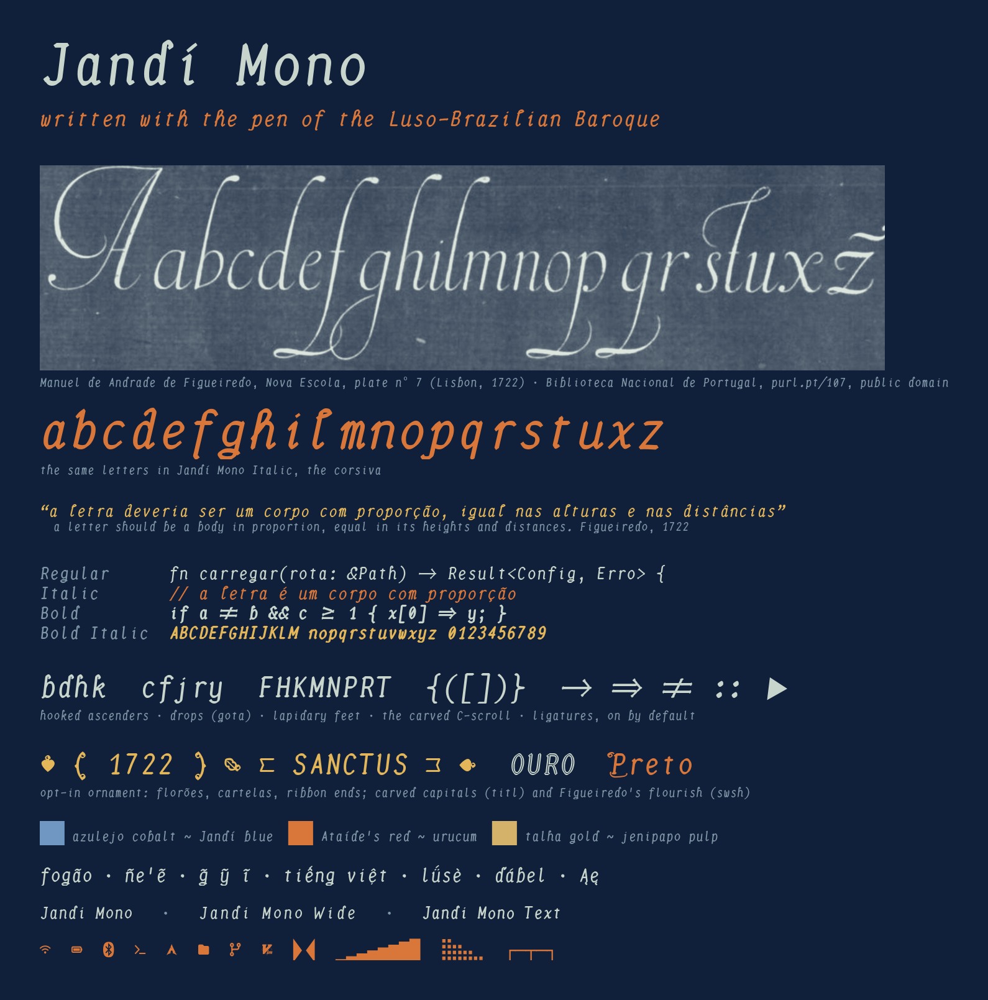

# Jandí Mono

A monospaced font for terminals and desktops: **Monaspace Radon's cursive,
rewritten with a Renaissance pen.** Made for the
[Jandí theme for Omarchy](https://github.com/arnaudmatheus/omarchy-jandi-theme).



## What it is

Radon is Monaspace's handwriting face: warm, slanted, drawn with an even
marker-like stroke. Jandí Mono keeps Radon's vertical metrics, symbols, box
drawing and OpenType features, and redraws its letters the way a
chancery scribe would: every letter is a centreline swept by **one rectangular
nib held at one fixed angle (35°)**. Thick and thin are never drawn by hand;
they fall out of the pen angle, the same for every letter. The hand lifts
between letters (no joins), which is exactly what a monospace grid needs.

- **Subtle contrast** (≈1.6 : 1), so hairlines survive 9 pt on a 96 PPI screen.
- **Chancery `f`** with a descender, and a **`g` whose looped descender closes
  in one sweep**, inspired by Michelangelo's signature.
- **Measured legibility:** confusable letters are checked by a harness
  (`tools/measure.py`, results in [docs/metrics.md](docs/metrics.md)): a
  flagged and footed `1`, an `l` with a sweeping tail, a serifed `I`, a slashed
  `0` narrower than `O`, a notched `a` against a round `o`, `f` and `j` with
  hooks of different sizes.
- **A taller x-height than Radon** (+5%), so 12 pt clears the ≈0.2° critical
  print size of reading research on a typical desktop monitor.
- **Writes Tupi and Guarani correctly.** Radon has no mark positioning, so
  `g` + U+0303 leaves the tilde floating beside the `g`. Jandí Mono adds GPOS
  mark attachment: `g̃ G̃ ỹ ĩ ũ ẽ` sit right, and so do Vietnamese stacks and
  the Czech/Slovak apostrophe carons (`ď ľ ť Ľ`).
- **Radon's texture healing still works:** its widened and shifted letter
  variants are regenerated from the same skeletons.
- **A tighter cell than Radon:** 1160 units (0.58 em) instead of 1240, so the
  narrower chancery letters don't float apart. Radon's symbols and box
  drawing are scaled with it, so box lines still meet edge to edge.
- **Baroque letters, after Manuel de Andrade de Figueiredo's *Nova Escola*
  (1722).** The Regular takes his hooked ascenders and ball terminals, with
  lapidary feet on the capitals. The Italic is a *corsiva* with his loops and
  *rasgos*, and leans 13° against the Regular's 7°. Italic comments read apart
  from code by shape as well as by angle.
- **Every change is measured** (`docs/metrics.md`): no ornament ships if it
  makes an easily confused pair (`r/n`, `l/1/I`, `c/o`…) harder to tell apart.
- Regular, Bold, Italic, Bold Italic.

## Families

| Family | Use |
|---|---|
| `Jandi Mono` | Text only |
| `Jandi Mono NF` | Plus 10,828 Nerd Fonts icons for bars, prompts and editors, and braille for btop-style graphs (upstream Radon has no braille) |
| `Jandi Mono Wide` | The same letters in a wider cell (1320 instead of 1160), for readers who need extra space between letters |
| `Jandi Mono Wide NF` | Wide, plus the Nerd Fonts icons |

## Install

```sh
git clone https://github.com/arnaudmatheus/jandi-mono
mkdir -p ~/.local/share/fonts/JandiMono
cp jandi-mono/fonts/otf/*.otf ~/.local/share/fonts/JandiMono/
fc-cache -f
```

On Omarchy, make it the system font (terminals, bar, menus):

```sh
omarchy font set "Jandi Mono NF"
```

## Build

```sh
pip install -r requirements.txt
./build.sh            # or: ./build.sh /path/to/python
```

`tools/pen.py` holds the pen engine and the lowercase skeletons,
`tools/caps.py` the capitals, figures and extra letters, `tools/marks.py` the
diacritics. `tools/merge.py` writes them into the upstream Radon fonts in
`sources/upstream/`; `tools/nerd.py` adds the icons from an installed
MonaspiceRn Nerd Font (set `NF_DIR` if it isn't in `/usr/share/fonts/OTF`).
`SPEC.md` records the design decisions, `ROADMAP.md` what comes next, and
`tools/measure.py` the numbers each change has to improve.

## Credits

- **Monaspace Radon**, the base: Riley Cran and the Lettermatic team, for
  [GitHub Next](https://github.com/githubnext/monaspace). SIL OFL 1.1.
  Jandí Mono is a derivative and does not use Monaspace's Reserved Font Names.
- **Nerd Fonts** icons in the NF builds: Ryan L McIntyre and
  [contributors](https://github.com/ryanoasis/nerd-fonts). Each icon set keeps
  its own licence; see the Nerd Fonts repository.
- **The Jandí palette and name**: [jandi-colors](https://github.com/franciscotbjr/jandi-colors)
  by Francisco Tarcizo Bomfim Júnior (MIT), from the blue pigment of the
  jenipapo fruit, the ancestral paint of Brazil's indigenous peoples.
- **Michelangelus** (Microsoft with Studiogusto, for the Fabbrica di San
  Pietro): inspiration only, from its makers' published design principles.
  No outlines, measurements or data from it are used; its licence forbids it.
  Jandí Mono is not affiliated with or endorsed by any of the above.

## Licence

SIL Open Font License 1.1, see [OFL.txt](OFL.txt). Changes are logged in
[FONTLOG.txt](FONTLOG.txt).
